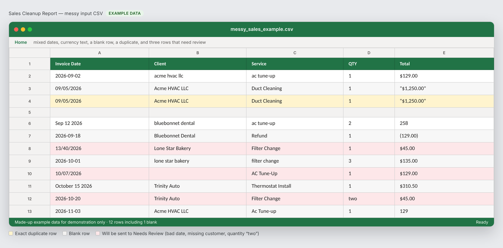
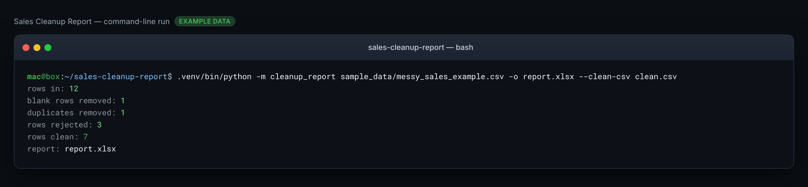
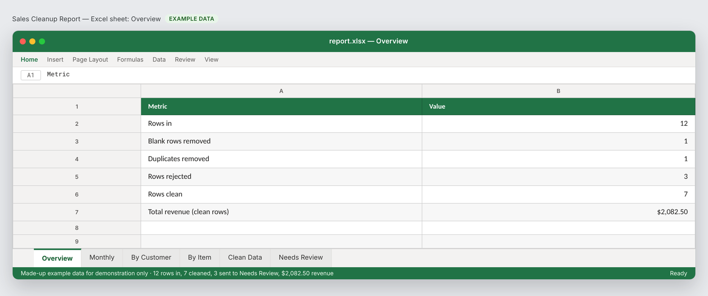
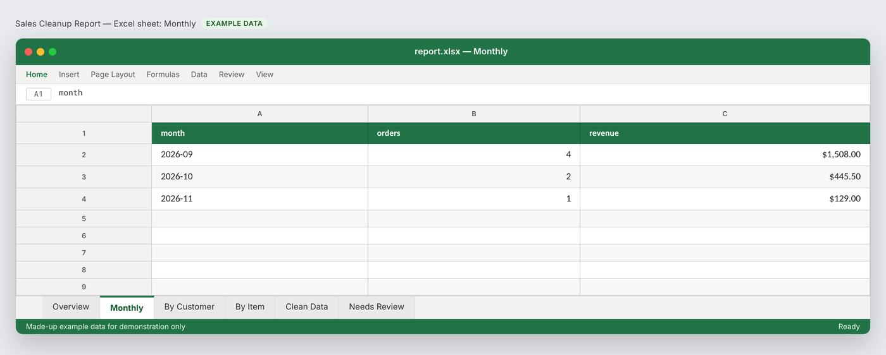
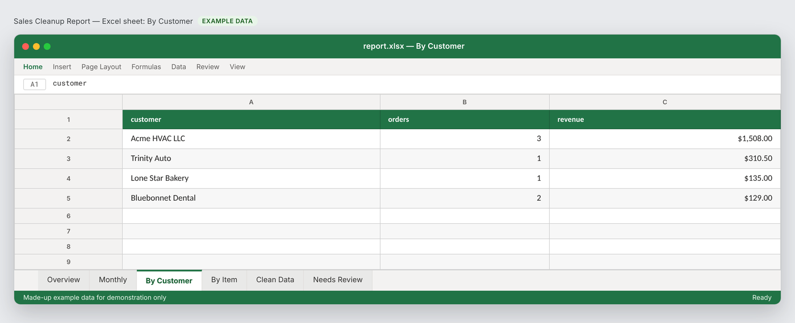
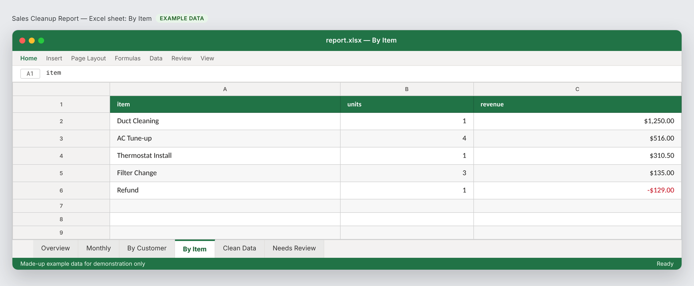
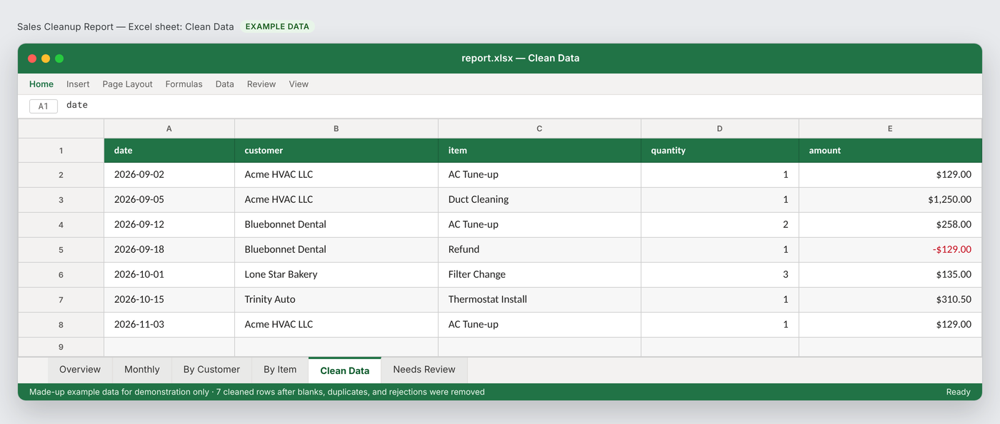
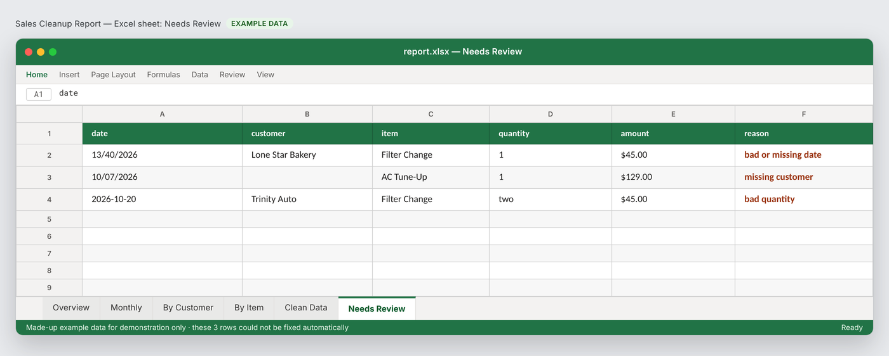
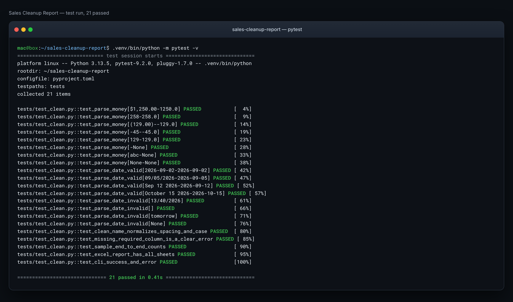

# Sales Cleanup Report

A command-line tool that turns a messy sales or invoice CSV export into clean data and an Excel summary report.

It is for small-business operators and bookkeepers whose POS, invoicing, or field-service exports arrive with inconsistent headers, mixed date formats, currency text, messy names, blank rows, and duplicates. The tool maps those exports to one standard layout, cleans what it can, and sends rows that cannot be fixed to a **Needs Review** sheet instead of dropping them silently.

The stack is **Python 3, pandas, and openpyxl**.

What it fixes:

- Inconsistent headers (`Invoice Date`, `Client`, `QTY`, `Total`…) mapped to one standard layout
- Mixed date formats (`2026-09-02`, `09/05/2026`, `Sep 12 2026`)
- Currency text (`$1,250.00`, refunds written as `(129.00)`)
- Extra spaces and inconsistent capitalization in names
- Blank rows and exact duplicate rows
- Rows that can't be fixed go to a **Needs Review** sheet with the reason, and nothing is silently dropped

## Output

An Excel workbook with the sheets Overview, Monthly, By Customer, By Item, Clean Data, and Needs Review. You can also save the cleaned rows as a CSV.

## Usage

```bash
python -m venv .venv && .venv/bin/pip install -e ".[dev]"
.venv/bin/python -m cleanup_report sample_data/messy_sales_example.csv -o report.xlsx --clean-csv clean.csv
```

## Tests

```bash
.venv/bin/python -m pytest
```

The tests cover each cleaning rule, the full sample run, the Excel output, and the command line's error handling.

## Screenshots

All data in these screenshots is **made-up example data** for demonstration only, taken from `sample_data/messy_sales_example.csv`.

### Messy input CSV



The sample export before cleaning: mixed date formats, currency strings, inconsistent capitalization, a blank row, an exact duplicate, and three rows that cannot be fixed automatically (an invalid date `13/40/2026`, a missing customer, and a quantity written as `two`). This is the kind of small-business export the tool is built to handle.

### Command-line run



Running the tool on that sample file reports 12 rows in, 1 blank row removed, 1 duplicate removed, 3 rows rejected, and 7 rows cleaned, and writes `report.xlsx`. The counts come from the cleaning rules, so you can see exactly what changed.

### Overview sheet



The Overview sheet summarizes those counts and the total revenue from the cleaned rows ($2,082.50). It is the first place to check that the cleanup did what you expected.

### Monthly sheet



Order counts and revenue by month (September through November 2026). Dates have been normalized, so the mixed input formats still roll up into the correct month.

### By Customer sheet



Customers ranked by revenue after names were normalized — for example `acme hvac llc` and `Acme   HVAC LLC` both become Acme HVAC LLC, so the same customer is not split across spellings.

### By Item sheet



Items ranked by revenue, with units sold. The refund appears as a negative amount so it is not lost in the totals.

### Clean Data sheet



The seven rows that passed every cleaning rule, with standard columns (`date`, `customer`, `item`, `quantity`, `amount`), ISO dates, title-cased names, and numeric amounts, including the −$129.00 refund.

### Needs Review sheet



The three rows that could not be fixed, still in their original form, each with a reason: bad or missing date, missing customer, and bad quantity. Nothing is dropped without an explanation.

### Test run



The pytest suite: 21 tests passed, covering money and date parsing, name normalization, missing-column errors, the sample end-to-end run, Excel sheet output, and CLI error handling.
